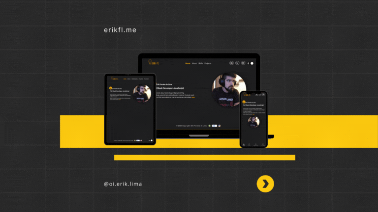

<h1 align="center"> ☀️ Portfolio 🔎</h1>

<div align="center" style=''>



</div>

## 📓 Sobre

O projeto foi desenvolvido com o intuito de mostrar meus projetos e habilidades.

<details>
  <summary>Sobre o desenvolvimento</summary>
  <br />

  Para o desenvolvimento do projeto, utilizei o framework ReactJS, com o objetivo de praticar e aprender mais sobre a biblioteca. O projeto foi desenvolvido com o intuito de mostrar meus projetos e habilidades, além de ser um portfólio pessoal.
  Além do outras bibliotecas, como o React Router Dom, para a navegação entre as páginas, e o React Icons, para a utilização de ícones, styled-components, para a estilização dos componentes entre outras bibliotecas.

  <br />
</details>


  ### Habilidades utilizadas durante o desenvolvimento 💻

<details>
  <summary> 🦾 Habilidades</summary>
  <br />

  * Desenvolvimento de aplicações React
  * Desenvolvimento de portfólio
  * Desenvolvimento de aplicações responsivas
  * Desenvolvimento de aplicações com React Hooks
  * Desenvolvimento de aplicações com React Router
  * Metodologia ágil(Kanban)

  <br />
</details>

<details>
  <summary> 🖥️ Tecnologias</summary>
  <br />

  * React.js
    * Components Funcional
    * Hooks
    * React Router
  * HTML5
  * CSS3
  * JavaScript
  * Material-ui
  * Styled-components
  * Git
  * GitHub-pages
  * Vercel

  <br />
</details>

<details>
  <summary> 🖥️ Implementações futuras 🖥️</summary>
  <br />

  * Front-end
    * Aplicar atomic design
    * Criar easter eggs na página
    * Criar uma página de contato/ About me
    * Criar area de admin para verificar informações sobre acessos e ter um controle sobre as
      melhoras que possam ser feitas no site
    * Aplicar testes unitários
  * Back-end
    * Criar uma api para armazenar os dados dos projetos
    * Criar testes de integração
    * Criar testes E2E
    * Aplicar testes unitários

  <br />
</details>

  <br />

### 🤝 Colaboradores 💻

<br />
<table>
  <tr>
      <td align="center">
      <a href="https://github.com/erik-efl">
        <br>
        <sub>
          <b>Erik Lima</b>
        </sub>
      </a>
    </td>
  </tr>
</table>

<br />

##

## ⚙️ Status do Projeto 🛠️

  ```js
    let projeto {
      "status": "Em desenvolvimento"
    }
  ```
##

## Firebase Functions: configuração local e deploy

### Preparar o projeto Firebase

1. Crie ou selecione um projeto no [Firebase Console](https://console.firebase.google.com/).
2. Em **Authentication → Sign-in method**, habilite **Email/Password**.
3. Crie o usuário administrador em **Authentication → Users → Add user**. Adicione o email exato à configuração `ADMIN_EMAILS` das Functions. A autorização administrativa deve ser validada no backend; ocultar rotas na interface não é controle de acesso.
4. Em **Storage**, crie/ative o bucket do projeto e copie o valor do bucket para `VITE_FIREBASE_STORAGE_BUCKET`.
5. Registre um app Web no Firebase Console e copie a configuração pública para a raiz `.env` com base em `.env.example`.
6. Configure a região das Functions no backend; os exemplos abaixo usam `us-central1`.

Os campos `VITE_FIREBASE_*` são configuração pública do SDK Web, não credenciais de servidor. Nunca coloque chaves de service account, `APPBACKEND_COLLECTION_ID` ou outros segredos em variáveis `VITE_*`: o Vite publica esses valores no bundle do navegador.

### Configuração privada das Functions

Copie `functions/.env.example` para `functions/.env.<project-id>` e defina os emails administrativos e origens permitidas. `ADMIN_EMAILS` é uma lista separada por vírgulas. `CORS_ALLOWED_ORIGINS` precisa conter as origens exatas (scheme, host e porta), sem caminho nem wildcard; inclua `http://localhost:5173` e `http://127.0.0.1:5173` para desenvolvimento local.

Configure `APPBACKEND_COLLECTION_ID` exclusivamente como secret do Firebase Functions/Secret Manager:

```sh
firebase functions:secrets:set APPBACKEND_COLLECTION_ID --project <project-id>
```

O comando solicita o valor sem colocá-lo na linha de comando. O backend precisa associar esse secret às Functions que o usam. Para emuladores locais, crie `functions/.secret.local` com os três secrets que a Function consome; não o versione nem compartilhe:

```dotenv
APPBACKEND_COLLECTION_ID=<valor-local>
ADMIN_EMAILS=seu.email@exemplo.com
CORS_ALLOWED_ORIGINS=http://localhost:5173,http://127.0.0.1:5173
```

`APPBACKEND_COLLECTION_ID` é o id da tabela no appbackend.io: 12 caracteres alfanuméricos, copiado do painel da tabela. Um valor com outro formato faz o backend de conteúdo responder `404 Table document not found`, que aparece no app como `Admin API request failed (404)`.

### Contrato da tabela de conteúdo

A tabela guarda uma linha por seção, com as colunas `key` (nome da seção) e `value` (JSON da seção). As colunas são criadas no primeiro POST. O backend já absorve as particularidades do serviço:

- `GET /v1/rows/{tabela}` responde `{ data, page, count, perPage }` e pagina de 100 em 100; a Function desembrulha e segue as páginas, devolvendo um array para o app.
- Leituras passam por CDN: toda requisição de leitura leva um `_=<timestamp>` para não servir conteúdo velho depois de salvar ou excluir.
- Escritas são eventualmente consistentes: a linha criada volta no POST, e o painel usa essa resposta para atualizar o cache (senão um segundo "Salvar" criaria duplicata). Exclusões somem da listagem em alguns segundos — confirme pelo `GET /v1/rows/{tabela}/{_id}`, que responde 400 `Not found` quando a linha já saiu.


Sem esse arquivo a Function responde `503 CORS_NOT_CONFIGURED` e o navegador mostra apenas `Failed to fetch`, porque nenhuma resposta com erro de configuração passa pelo CORS.

### Desenvolvimento e deploy

Use Node.js `20.19+` ou `22.12+` (necessário para a versão atual do Vite e do Firebase CLI). Instale dependências na raiz e copie `.env.example` para `.env`, preenchendo os valores do app Web. Para usar os emuladores, aponte o frontend para eles:

```dotenv
VITE_ADMIN_API_URL=http://127.0.0.1:5001/demo-project/us-central1/api
VITE_FIREBASE_AUTH_EMULATOR_HOST=127.0.0.1:9099
```

`VITE_FIREBASE_AUTH_EMULATOR_HOST` faz o app autenticar no emulador de Auth em vez do projeto real; deixe a variável vazia em builds de produção. O emulador de Functions precisa rodar junto do de Auth, pois valida o ID token recebido.

Inicie os emuladores:

```sh
npm install
node functions/scripts/start-firebase-emulators.mjs
```

O script inicia os emuladores configurados (Auth, Functions, Firestore, Storage e UI) sempre no projeto local `demo-project`; não exige login no Firebase.

Crie o administrador local com email verificado (a Function exige `email_verified`):

```sh
npm run firebase:seed:auth
```

O emulador de Auth mantém os usuários apenas em memória: rode o script de novo a cada reinício dos emuladores (é idempotente, atualiza quem já existe). Ele usa o primeiro email de `functions/.secret.local` e a senha padrão `admin123456`; passe email e senha como argumentos para sobrescrever.

O projeto demo usa `http://127.0.0.1:5001/demo-project/us-central1` como base local das Functions, `http://127.0.0.1:9099` para Auth, `http://127.0.0.1:8080` para Firestore, `http://127.0.0.1:9199` para Storage e `http://127.0.0.1:4000` para a UI dos emuladores. Use `npm run functions:build` para compilar as Functions.

Associe o projeto real e publique apenas as Functions:

```sh
firebase login
firebase use <project-id>
npm run firebase:deploy:functions
```

O deploy executa o build configurado em `functions/package.json`. Para validar o frontend, use os scripts existentes `npm run dev`, `npm run build` e `npm run preview`.

O projeto não configura Firebase Hosting nem pressupõe um provedor de deploy. Em hospedagem estática, configure a URL pública exata da Function no frontend (por exemplo, `VITE_FUNCTIONS_BASE_URL`) e inclua a origem final do site, exatamente, em `CORS_ALLOWED_ORIGINS`. Repita isso para cada domínio/ambiente; não use curingas. Consulte o Firebase Console ou `firebase functions:list --project <project-id>` para obter a URL realmente publicada.

Execute `npm run typecheck` para verificar os tipos do projeto; `tsconfig.json` usa `module: ESNext` com `moduleResolution: bundler`, compatíveis com Vite.

### ©️ Aviso de direitos autorais

</br>

Esse projeto foi desenvolvido para propósitos de aprendizagem e divulgação de meus projetos, todo o código e documentação são da autoria de [Erik-EFL](https://github.com/Erik-EFL) e os direitos pertencem exclusivamente a [Erik-EFL](https://github.com/Erik-EFL). É permitido baixar ou clonar o repositório para fins de estudo. Contudo, não é permitido publicar cópias totais ou parciais. Este aviso não cobre bibliotecas, dependências ou marcas, estas estão sujeitas a suas respectivas licenças.
